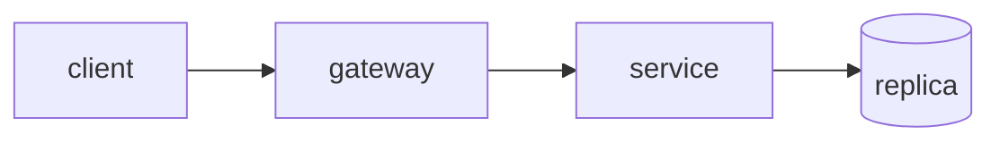

# pinpoint

**Scope.** This file is tool instructions loaded as context — it is not the
conversation topic. Resolve references in the user's message against the
workspace and session context, not against this document, unless the user
explicitly asks about pinpoint itself.

**Invocation precedence.** The When-to-use gate decides when you reach
for pinpoint on your own. An explicit invocation — the user names pinpoint,
links it, or pastes it with a request — satisfies the gate outright: run
the loop on the user's request. When an explicit invocation looks
mismatched (it seems to call for a quick chat answer), name the mismatch
once and ask; the user's choice settles the channel.

Point-to-point feedback on long AI responses. When your reply is long or
structured, plain chat makes it hard for the user to say exactly which part
they want changed. pinpoint turns the reply into a web page. The user clicks
any block and writes a note on it. You consume every note one by one. The
document converges, then exports to clean markdown.

The document is a communication medium, not the deliverable. If the user
just wants the final file changed, edit the file directly instead.

## When to use

Open a pinpoint document on your own initiative only when BOTH are true
(an explicit invocation bypasses this gate — see Invocation precedence):

1. The content is long or structured (report, plan, multi-part answer,
   code review, comparison table).
2. The expected feedback is local ("change this part"), not global.

AND one of:

- You judge the reply too complex to discuss in chat, or
- The user asks for an annotatable page.

Use chat instead when:

| Situation | Channel |
|---|---|
| Short reply, simple question | Chat |
| Global or directional feedback ("wrong tone", "redo") | Chat |
| Precise small fix on a final file ("change title to X") | Edit the file |
| Reply is still being explored, rewritten every round | Chat; open a document once content stabilizes |

## The loop

Work from the skill directory (`${SKILL_DIR}/scripts`). Use `python` on
Windows, `python3` on macOS/Linux. The workspace is `<project>/.pinpoint/`:
runtime state, self-ignored from git (a `*` `.gitignore` is written into
it), so nothing there can reach the remote.

1. **Render your reply into a document.** Write the reply as markdown, then:

   ```bash
   python ${SKILL_DIR}/scripts/render.py reply.md
   ```

   Raw `.html` and image files also work as input; the command prints the
   created doc path. Draw structure and UI instead of describing them —
   flows, architectures, sequences, state machines, taxonomies, timelines
   become ` ```mermaid ` fenced blocks; screen layouts and UI sketches
   become ` ```mockup ` blocks. See [Drawn figures](#drawn-figures).

2. **Start the editor and give the user the URL.**

   ```bash
   python ${SKILL_DIR}/scripts/server.py --daemon
   ```

   Give the user the deep link `http://127.0.0.1:<port>/#<doc-name>.html`
   (read the port from launch output). On first open the server migrates
   the doc to the markdown master you edit from here on
   (`docs/<name>.md`). Tell the user, in their language, in one short
   message: the URL; they click any block — even a node inside a rendered
   diagram — to write an annotation for you, edit plain text themselves,
   and confirm **Apply changes** to submit — you pick it up
   automatically, no chat go-signal needed; confirming **Apply changes**
   with nothing staged submits full agreement (no comments); an Apply
   **with** staged work asks what the blocks they did *not* annotate
   mean — *not decided yet* (the default) or *agree* (silence is not
   consent). Lifecycle and remote access:
   [`references/editor.md`](references/editor.md).

3. **Wait for the apply — blocked, hands off.** Right after handing over
   the URL, start the waiter:

   ```bash
   python ${SKILL_DIR}/scripts/wait.py
   ```

   It blocks until the user confirms **Apply changes** in the browser,
   then prints the per-round digest: every pending annotation quotes its
   master region; direct edits are FYI only — already in the master.
   `[APPLIED] full agreement` means the user submitted with **nothing
   staged** — they agree with the whole document: nothing to consume,
   converge the round (export / finish). `[APPLIED] empties=undecided`
   (the 0026 default for an Apply with staged work) means the user
   **holds the un-annotated blocks undecided** — a stated position, not
   approval: consume the notes, then wait again; do not converge,
   answer, or export for them. `[APPLIED] empties=agreed` approves the
   rest: once the notes are consumed the document is converged. A bare
   empty digest (`[OK] No annotations found.`) without any note means
   the user applied deletions only, or there was nothing new. Never
   consume before this releases. The wait ends without a digest when
   the server stops (idle timeout with no tab open, Exit button,
   `--shutdown`) or you cancel it; nothing is lost — ask the user, then
   run `digest.py` yourself (the manual fallback).

4. **Edit the master `docs/<name>.md` directly** — plain markdown:
   rewrite, split, insert, delete blocks as the notes ask. Each note is
   a marker line above its block ([Markers](#markers)): fix = edit
   content and delete the marker; explain without fixing = delete the
   marker and explain in your reply. Pass a fix-less explanation to
   step 5 as `--explain b<N>=<why>` to record it in the audit too.

5. **Consume the round:**

   ```bash
   python ${SKILL_DIR}/scripts/consume.py <doc>
   ```

   consume re-anchors your edits against the baseline snapshot, acks
   every deleted marker, writes the audit records, and refuses the whole
   round if a marked block was deleted with its marker (follow the
   error, fix, run again). Tell the user what changed; ask for a
   refresh; new annotations restart at step 3. Server keeps running.

6. **When done**, export the converged document (markers stripped):

   ```bash
   python ${SKILL_DIR}/scripts/export.py <doc> -o final.md
   ```

   Export **refuses an unconverged review** (0026): markers still
   waiting to be consumed, or a last Apply that left the rest
   undecided. Converge first (consume the notes, then an
   `empties=agreed` or nothing-staged Apply); `--draft` exports a
   working snapshot anyway — only when the user asks for one — marked
   by a leading HTML comment, because silence is not consent.

   Then stop the server if the user is finished:
   `python ${SKILL_DIR}/scripts/server.py --shutdown`, and archive the
   finished review so the doc list stays short:

   ```bash
   python ${SKILL_DIR}/scripts/clean.py --name <doc> --apply
   ```

   It moves the doc — with its baseline, empties entry, and
   unreferenced assets — to `.pinpoint/archive/<timestamp>/`, one
   reversible batch (restore = move the files back). It never touches
   a doc with unconsumed notes or a held undecided position, and
   `annotations.jsonl` is audit memory — it stays forever. When old
   reviews pile up in the list instead, run `clean.py` on the
   workspace: dry-run by default (a verdict table, nothing written),
   `--apply` to execute, `--stale-days` governs never-reviewed
   leftovers (default 30 days).

Protocol details: [`references/protocol.md`](references/protocol.md).

## Drawn figures

A reply that is mostly structure or visuals reads faster as a picture.
Draw instead of stacking prose and nested lists:

- **Relationships** — flow, architecture, sequence, state, taxonomy,
  timeline, split of a whole: a ` ```mermaid ` block.
- **UI sketches** — panels, toolbars, forms, dialogs, screen layouts: a
  ` ```mockup ` block holding plain HTML styled with inline `style`
  attributes.
- **Vector illustrations** — a ` ```svg ` block.

Tables stay tables; relationships get diagrams, screens get mockups.
All three draw the same way — the source stays a fenced block, the
editor renders it live:

````

````

````
```mockup
<div style="display: flex; gap: 8px">
  <button style="padding: 4px 12px">Save</button>
  <button style="padding: 4px 12px">Cancel</button>
</div>
```
````

Rules:

1. **One idea per figure, under ~15 nodes.** Big figures cannot be
   discussed precisely; split into one figure per aspect. Prefer `LR`
   (left-to-right) for pipelines, `TD` for hierarchies.
2. **Labels and element text carry the domain terms** the user would use
   in feedback ("make gateway cache" must point at an unambiguous box;
   "this Save button" at exactly one button).
3. **Mockups: inline styles only, one element per line.** `<style>`
   blocks are stripped (rules would leak into the editor page); scripts,
   iframes, and link navigation are stripped too — a mockup is a
   picture, not an app. No external images (the editor blocks them):
   inline SVG or emoji for icons. ` ```html ` stays a plain code listing;
   ` ```mockup ` is the draw-me fence.
4. **Keep figures as source, never rasterize.** The doc stores the
   source; the editor renders it live and export round-trips it back to
   a fenced block. Replacing it with an image destroys element-level
   annotation.
5. Mermaid labels stay plain text — no HTML in labels (the editor
   renders with `securityLevel: strict`). Works for: `flowchart`,
   `sequenceDiagram`, `classDiagram`, `stateDiagram-v2`, `erDiagram`,
   `gantt`, `mindmap`, `pie`, `journey`.

How annotation lands: clicking a **drawn element** annotates the source
line that defines it (mermaid: node id/label matched to the line;
mockup/svg: sequential opening-tag alignment, so keep elements on their
own lines — an element the aligner cannot place falls back to the whole
figure); clicking **elsewhere** annotates the **figure** (whole source,
visible via the figure's *View source* toggle). Consume such notes by
editing the source line, like a code line.

## Multiple topics in one conversation

Each topic gets its own document (its own master). Before opening a new one:

1. Empty the previous topic's inbox first: `digest.py` prints
   `[OK] No annotations found.` when nothing is pending. Consume or
   withdraw every leftover note.
2. Name the new document after its topic (`--name <topic>`). Rendering
   over an existing name is refused — pending annotations or a master
   that already owns the name protect the active conversation.
3. A converged master stays in `docs/` and the sidebar; to retire it,
   move it out of `docs/` (e.g. to `.pinpoint/archive/`).

## Markers

A note lives in the master as one marker line directly above the block it
annotates: `<!-- pp: note -->` = the block below is annotated;
`<!-- pp@N: note -->` = line N of the fenced block below (blanks count).

1. **Delete the marker to resolve the note.** Deleted with content
   unchanged = ack; content edited too = fix-and-ack; marker kept =
   pending (back in the next digest). Never leave a note without either
   a fix or a spoken explanation.
2. **Never delete a marked block together with its marker.** consume
   refuses the whole round — resolve the note first (fix it, or delete
   the marker and explain in your reply), then restructure.
3. **Edit fences like plain text.** A `pp@N` note points into the fence
   below it; fix code by editing that line, keeping the fence intact.
4. **No ids, no attributes.** The master is plain markdown; ids and
   annotation attributes exist only in the browser projection — the
   server manages them.
